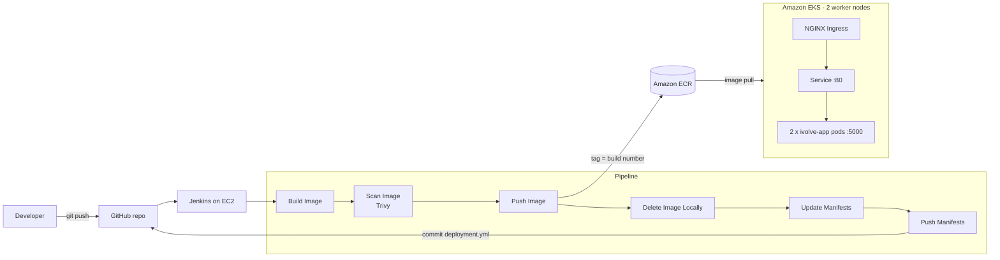

# CloudDevOpsProject

An end-to-end DevOps project that takes a small Flask web app from source code to a Kubernetes deployment on AWS. Terraform provisions the network, a Jenkins server, a container registry (ECR) and an EKS cluster. Ansible configures the Jenkins server. A Jenkins pipeline built on a shared library builds the Docker image, scans it with Trivy, pushes it to ECR, and updates the Kubernetes manifests with the new image tag.

## Architecture



**AWS infrastructure (Terraform, region `us-east-1`)**

- VPC `10.0.0.0/16` across two Availability Zones (`us-east-1a`, `us-east-1b`) with 2 public and 2 private subnets, an internet gateway, and a NAT gateway.
- Jenkins server: an Ubuntu EC2 instance (`t3.micro`) in a public subnet.
- ECR repository `ivolve-app` with a lifecycle policy that keeps the last 10 images.
- EKS cluster (Kubernetes 1.33) with a managed node group of 2 worker nodes (`t3.micro`) in the private subnets.
- Terraform state is stored in an S3 backend.

## Tech Stack

| Area | Tools |
| --- | --- |
| Application | Python, Flask |
| Containers | Docker |
| Infrastructure as Code | Terraform (modules: network, server, ecr, eks) |
| Configuration management | Ansible (roles and AWS EC2 dynamic inventory) |
| CI | Jenkins (declarative pipeline, shared library) |
| Security scanning | Trivy |
| Registry | Amazon ECR |
| Orchestration | Kubernetes on Amazon EKS, NGINX Ingress |
| Cloud | AWS (VPC, EC2, ECR, EKS, S3) |

## CI/CD Pipeline

The `Jenkinsfile` loads a shared library (`@Library('shared-library')`) and runs these stages. Each stage calls a helper from the `vars/` directory.

1. **Build Image**: runs `docker build` to create the `ivolve-app` image from the `Dockerfile`.
2. **Scan Image**: runs Trivy on the image. The stage fails the pipeline if any `HIGH` or `CRITICAL` vulnerability is found.
3. **Push Image**: logs in to ECR, tags the image with the Jenkins build number, and pushes it.
4. **Delete Image Locally**: removes the local image and the ECR-tagged image from the Jenkins server to free disk space.
5. **Update Manifests**: rewrites the `image:` line in `kubernetes/deployment.yml` to point at the new ECR image and build-number tag.
6. **Push Manifests**: commits the updated `deployment.yml` and pushes it to the `main` branch.

The pipeline prints a success or failure message in the `post` section.

## Repository Structure

```text
.
├── app.py                  # Flask application (listens on port 5000)
├── requirements.txt        # Python dependencies
├── Dockerfile              # python:3.13-alpine image
├── Jenkinsfile             # CI pipeline
├── templates/              # HTML template
├── static/                 # CSS and logos
├── vars/                   # Jenkins shared library steps
├── jenkins/vars/           # Copy of the shared library steps
├── kubernetes/
│   ├── namespace.yml
│   ├── deployment.yml
│   ├── service.yml
│   └── ingress.yml
├── ansible/
│   ├── ansible.cfg
│   ├── playbook.yml
│   ├── inventory/aws_ec2.yml
│   └── roles/              # java, jenkins, docker, trivy
└── terraform/
    ├── backend.tf
    ├── main.tf
    ├── provider.tf
    ├── outputs.tf
    └── modules/            # network, server, ecr, eks
```

## Getting Started

### Prerequisites

- An AWS account and credentials with permission to create the resources above.
- Terraform, Ansible (with the `amazon.aws` collection), kubectl, and Docker installed locally.
- An EC2 key pair. The Terraform config uses a key named `ivolve-jenkins-key`, and `ansible/ansible.cfg` expects the private key at `~/.ssh/ivolve-jenkins-key.pem`.
- An S3 bucket for Terraform state. `terraform/backend.tf` points to `mohamed-clouddevops-tfstate`. Change it to a bucket you own.

### 1. Run the app locally

```bash
pip install -r requirements.txt
python app.py
# open http://localhost:5000
```

Or with Docker:

```bash
docker build -t ivolve-app .
docker run -p 5000:5000 ivolve-app
```

### 2. Provision the infrastructure

```bash
export AWS_ACCESS_KEY_ID=<your-access-key-id>
export AWS_SECRET_ACCESS_KEY=<your-secret-access-key>

cd terraform
terraform init
terraform plan
terraform apply
```

Outputs include `jenkins_public_ip`, `eks_cluster_name`, `eks_cluster_endpoint` and `ecr_repository_url`.

### 3. Configure the Jenkins server

```bash
cd ansible
ansible-playbook playbook.yml
```

The dynamic inventory finds the EC2 instance tagged `ivolve-jenkins` in `us-east-1`. The playbook applies the `java`, `jenkins`, `docker` and `trivy` roles.

### 4. Set up the Jenkins pipeline

In Jenkins, configure:

- A global shared library named `shared-library` that points to this repository (the helpers are in `vars/`).
- Credentials used by the pipeline: `AWS_ACCESS_KEY_ID` and `AWS_SECRET_ACCESS_KEY` (secret text), and `github-credentials` (username and password or token).
- A pipeline job that uses the `Jenkinsfile` from this repository.

Before you run it, update the values in the `Jenkinsfile` `environment` block (`ECR_URL`, `REGION`, `REPO_URL`) to match your own AWS account and repository.

### 5. Deploy to Kubernetes

```bash
aws eks update-kubeconfig --region us-east-1 --name <eks-cluster-name>

kubectl apply -f kubernetes/namespace.yml
kubectl apply -f kubernetes/
kubectl get pods -n ivolve
```

Notes:

- The Deployment runs 2 replicas with a pod anti-affinity rule on hostname, so the pods are scheduled on different nodes.
- The Service listens on port 80 and forwards to container port 5000.
- The Ingress uses the `nginx` ingress class, so an NGINX ingress controller must be installed in the cluster. The controller is not part of this repository.

## Skills Demonstrated

Infrastructure as Code with Terraform modules, configuration management with Ansible, Docker containerization, Jenkins pipelines with shared libraries, vulnerability scanning with Trivy, and Kubernetes deployment on AWS EKS.
